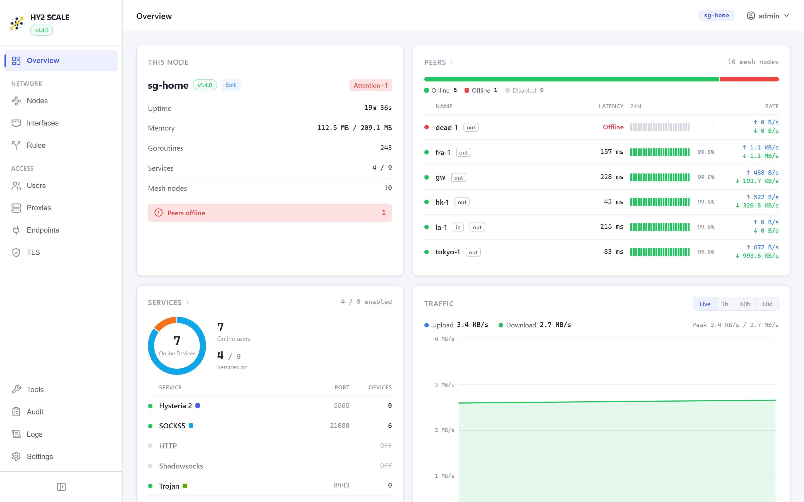
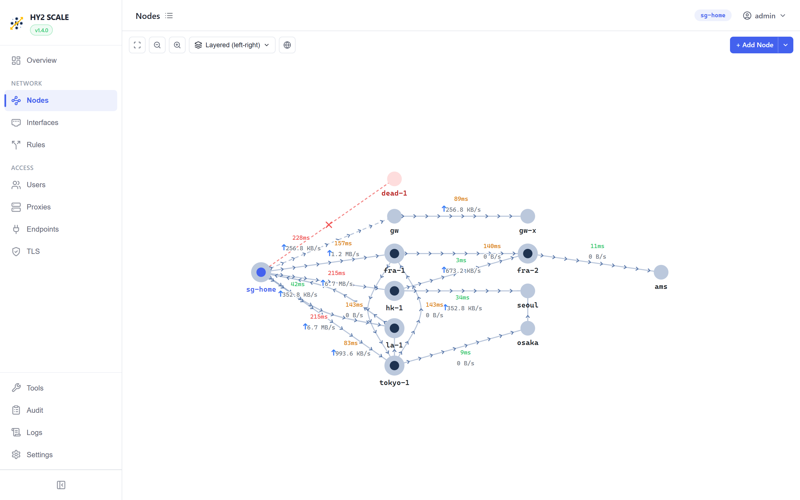
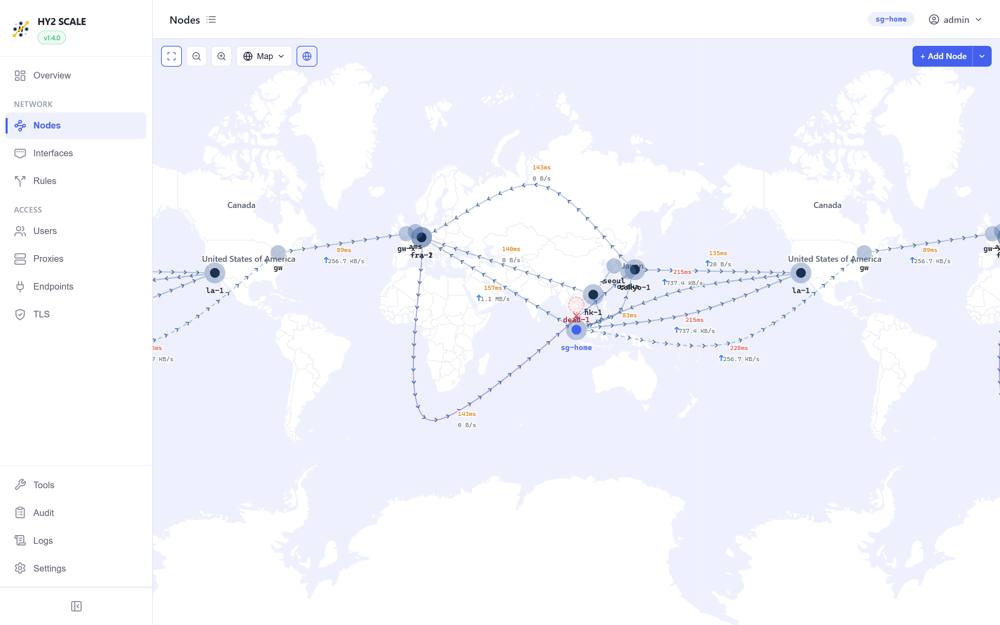
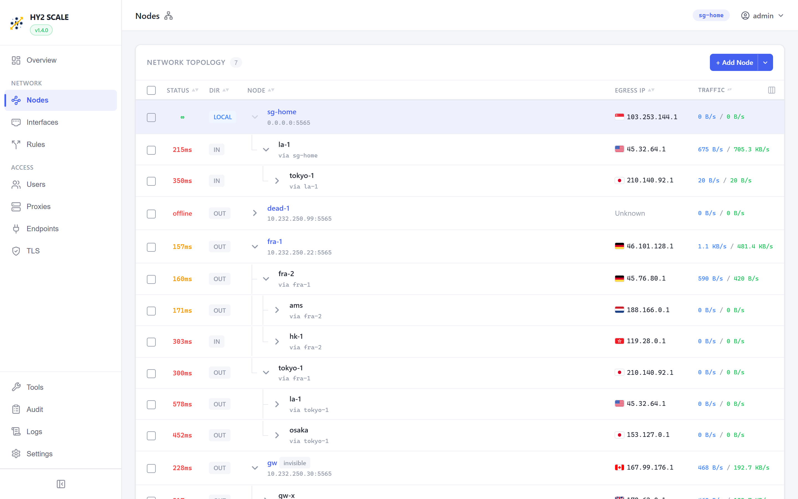

<p align="center">
  
</p>

<h1 align="center">HY2 SCALE</h1>

<p align="center">
  基于 Hysteria 2 的 Mesh 中继网络，内置 Web 管理界面。<br>
  通过任意节点转发流量、运行 VPN 服务，一切均可在浏览器中管理。
</p>

<p align="center">
  <a href="https://hub.docker.com/r/frankoong/hy2scale"></a>
  <a href="https://github.com/FrankoonG/hy2scale/wiki"></a>
  <br>
  <a href="README.md">English</a> | <b>中文</b> | <a href="README-ko.md">한국어</a>
</p>

---

完整安装、配置和 API 文档请参阅 **[Wiki](https://github.com/FrankoonG/hy2scale/wiki)**。

## 快速开始

### 一键安装（原生二进制 + systemd）

```bash
curl -fsSL https://raw.githubusercontent.com/FrankoonG/hy2scale/main/install.sh | sudo sh
```

自动识别 CPU 架构（`amd64` / `arm64` / `armv7` / `mips64le` /
`mipsle-softfloat`），从最新 release 下载匹配的 tar 包，把二进制装到
`/usr/local/bin/hy2scale` 并注册 systemd 服务。重复运行即原地升级。
固定版本用 `HY2SCALE_VERSION=v1.4.0`；卸载用 `… | sudo sh -s -- --uninstall`。

### Docker

Full 模式（Host 网络 — 全部功能启用）：

```bash
docker run -d --name hy2scale \
  --network host --privileged \
  -v hy2scale-data:/data \
  --restart unless-stopped \
  frankoong/hy2scale:latest
```

Bridge 模式（VPN + 代理，规则作用于其用户）：

```bash
docker run -d --name hy2scale \
  -p 5565:5565/tcp -p 5565:5565/udp \
  -p 500:500/udp -p 4500:4500/udp -p 1194:1194/udp -p 51820:51820/udp \
  -v hy2scale-data:/data \
  --restart unless-stopped \
  frankoong/hy2scale:latest
```

VPN 服务（IKEv2、L2TP/IPsec、OpenVPN、WireGuard）和代理均在用户态运行，不需要任何
capability 或设备，普通端口映射即可。路由规则在任何模式下都作用于它们的用户。
透明接管宿主机自身以及经其路由的主机的流量需要 `--network host` 和 `NET_ADMIN`；
服务端端口跳跃需要 `NET_ADMIN`。

打开 `https://<主机>:5565/scale/`（默认为自签名证书）— 默认登录 `admin` / `admin`。

iKuai v4 用户请从 [Releases](https://github.com/FrankoonG/hy2scale/releases) 下载 `.ipkg` 并通过应用商店安装 — 详见 [iKuai v4 指南](https://github.com/FrankoonG/hy2scale/wiki/iKuai-v4-Installation)。

## 功能特性

- 将节点连接成网状网络，通过其中任意一个节点转发流量，支持多层嵌套发现。
- 实时查看整个网络：概览仪表盘、拓扑图、列表，以及按节点所在国家绘制的世界地图。
- 运行 VPN / 代理服务：Hysteria 2、SOCKS5、HTTP、Shadowsocks、Trojan、L2TP/IPsec、IKEv2、OpenVPN（UDP 与 TCP）、WireGuard。VPN 服务器完全运行在用户态，无需特权。
- 策略集可按用户、来源、目标、域名（TLS SNI / HTTP Host）、国家或 ASN 分流，支持嵌套流程；可透明接管本机及转发的流量。
- 按用户设置出口（单一路径、质量优先故障转移、聚合，或策略集）、流量限额与周期重置、上行 / 下行限速、到期时间。
- 多地址对等节点、NAT 后节点之间的打洞直连、按地址指定出口网卡或源地址；接口页面支持子接口和逐接口的公网 IP 检测。
- TLS 证书管理，内置证书颁发机构（CA）。
- 每条连接的审计记录、系统日志，以及网络工具（Ping、路由追踪、吞吐量测试、终端）。
- 备份 / 恢复、带签名校验的应用内升级，界面支持 EN / 中文 / 한국어。

## 截图

以新加坡的本地节点（`sg-home`）为中心，对等节点分布在东京、大阪、首尔、香港、洛杉矶、法兰克福、阿姆斯特丹、多伦多和伦敦：






## 构建

```bash
git clone https://github.com/FrankoonG/hy2scale.git
cd hy2scale
docker build -t hy2scale .
```

## 说明

HY2 SCALE 使用 Hysteria 2 协议，与 Hysteria 项目以及 Tailscale 都没有隶属关系。

## Star 历史

<a href="https://www.star-history.com/?repos=FrankoonG%2Fhy2scale&type=date&legend=top-left">
 <picture>
   <source media="(prefers-color-scheme: dark)" srcset="https://api.star-history.com/chart?repos=FrankoonG/hy2scale&type=date&theme=dark&legend=top-left" />
   <source media="(prefers-color-scheme: light)" srcset="https://api.star-history.com/chart?repos=FrankoonG/hy2scale&type=date&legend=top-left" />
   
 </picture>
</a>
