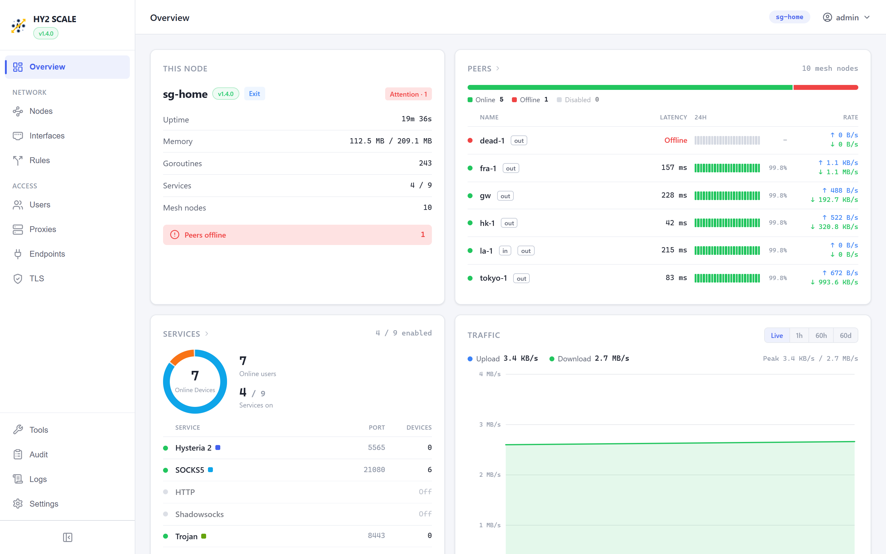
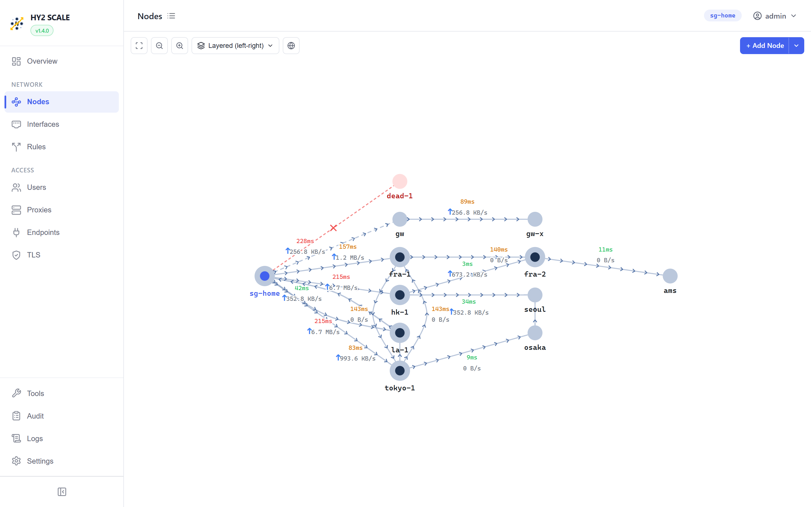
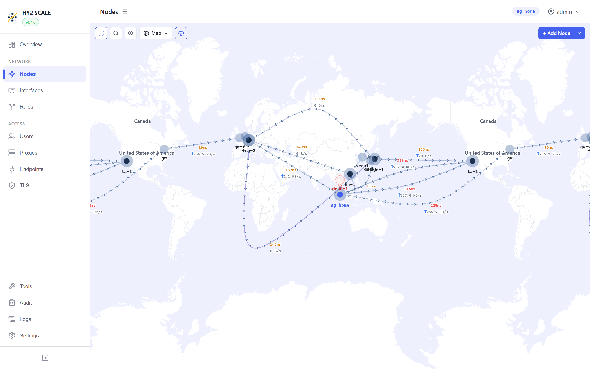
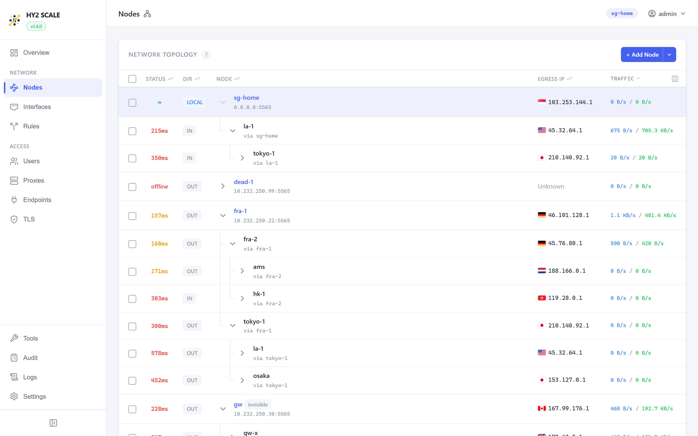

<p align="center">
  
</p>

<h1 align="center">HY2 SCALE</h1>

<p align="center">
  Hysteria 2 mesh relay network with a web management UI.<br>
  Route traffic through any node, run VPN services, manage everything from a browser.
</p>

<p align="center">
  <a href="https://hub.docker.com/r/frankoong/hy2scale"></a>
  <a href="https://github.com/FrankoonG/hy2scale/wiki"></a>
  <br>
  <b>English</b> | <a href="README-zh.md">中文</a> | <a href="README-ko.md">한국어</a>
</p>

---

See the **[Wiki](https://github.com/FrankoonG/hy2scale/wiki)** for full installation, configuration, and API documentation.

## Quick Start

### One-liner (native binary, systemd)

```bash
curl -fsSL https://raw.githubusercontent.com/FrankoonG/hy2scale/main/install.sh | sudo sh
```

Auto-detects the CPU architecture (`amd64`, `arm64`, `armv7`, `mips64le`,
`mipsle-softfloat`), downloads the matching tarball from the latest
release, installs the binary to `/usr/local/bin/hy2scale`, and registers
a systemd service. Re-running upgrades in place. Pin a version with
`HY2SCALE_VERSION=v1.4.3`; uninstall with `… | sudo sh -s -- --uninstall`.
On UniFi OS gateways (run as root) it installs under `/data/hy2scale`, kept across
firmware updates ([details](https://github.com/FrankoonG/hy2scale/wiki/Installation#unifi-os)).

### Docker

Full mode (host network — everything enabled):

```bash
docker run -d --name hy2scale \
  --network host --privileged \
  -v hy2scale-data:/data \
  --restart unless-stopped \
  frankoong/hy2scale:latest
```

Bridge mode (VPN + proxies; rules route their users):

```bash
docker run -d --name hy2scale \
  -p 5565:5565/tcp -p 5565:5565/udp \
  -p 500:500/udp -p 4500:4500/udp -p 1194:1194/udp -p 51820:51820/udp \
  -v hy2scale-data:/data \
  --restart unless-stopped \
  frankoong/hy2scale:latest
```

The VPN servers (IKEv2, L2TP/IPsec, OpenVPN, WireGuard) and proxies run in
userspace and need no capabilities or devices; plain port mapping is enough.
Routing rules apply to their users in every mode. Capturing the host's own
traffic and hosts routed through it (transparent rules) needs `--network host`
and `NET_ADMIN`; server port hopping needs `NET_ADMIN`.

Open `https://<host>:5565/scale/` (self-signed certificate by default) — default login `admin` / `admin`.

For iKuai v4, download the `.ipkg` from [Releases](https://github.com/FrankoonG/hy2scale/releases) and install via the app store — see the [iKuai v4 guide](https://github.com/FrankoonG/hy2scale/wiki/iKuai-v4-Installation).

## Features

- Connect nodes into a mesh and route traffic through any of them, several hops deep (nested discovery).
- See the mesh live: Overview dashboard, topology graph, list, and a world map of the nodes by country.
- Run VPN / proxy services: Hysteria 2, SOCKS5, HTTP, Shadowsocks, Trojan, L2TP/IPsec, IKEv2, OpenVPN (UDP and TCP), WireGuard. The VPN servers run fully in userspace, without privileges.
- Policy sets route traffic by user, source, destination, domain (TLS SNI / HTTP Host), country or ASN, with nested flows; transparent capture of the node's own and forwarded traffic.
- Per-user exits (single path, quality failover or aggregation, or a policy set), traffic limits with periodic reset, upload / download rate limits, expiry.
- Multi-address peers, hole punching between nodes behind NAT, and per-address outgoing interface or source address; sub-interfaces and per-interface public IP on the Interfaces page.
- TLS certificate management with a built-in certificate authority.
- Audit log of every connection, system logs, and network tools (ping, traceroute, throughput, terminal).
- Backup / restore, signed in-app upgrade, UI in EN / 中文 / 한국어.

## Screenshots

A Singapore home node (`sg-home`) with peers in Tokyo, Osaka, Seoul, Hong Kong, Los Angeles, Frankfurt, Amsterdam, Toronto and London:






## Building

```bash
git clone https://github.com/FrankoonG/hy2scale.git
cd hy2scale
docker build -t hy2scale .
```

## Notice

HY2 SCALE uses the Hysteria 2 protocol. It is not affiliated with the Hysteria project or with Tailscale.

## Star History

<a href="https://www.star-history.com/?repos=FrankoonG%2Fhy2scale&type=date&legend=top-left">
 <picture>
   <source media="(prefers-color-scheme: dark)" srcset="https://api.star-history.com/chart?repos=FrankoonG/hy2scale&type=date&theme=dark&legend=top-left" />
   <source media="(prefers-color-scheme: light)" srcset="https://api.star-history.com/chart?repos=FrankoonG/hy2scale&type=date&legend=top-left" />
   
 </picture>
</a>
